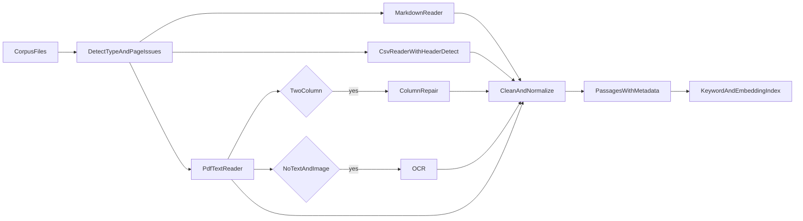

# Corpus prep plan for the RAG agent

The four files in `data/corpus` each need a different reader before they can be split into passages. One of them, the scanned memo, needs OCR because it has no text layer. After reading, every file has to be cleaned and split into passages that carry the file name and page number, so answers can cite their source.

## Tasks

- [x] Write the readers: Markdown, CSV with header-row detection, and PDF text with word positions
- [x] Add page checks: flag two-column pages for column repair, and flag pages with no text but an image for OCR
- [x] Install tesseract and OCR the scanned memo, with deskewing and black-and-white conversion first
- [x] Clean the text: remove handbook page footers but keep page numbers, normalize characters and spacing, and rejoin hyphenated words
- [x] Split into passages by section or heading, turn each CSV row into a passage, and attach metadata (file, page, section, extraction method, document date)
- [x] Eval questions are in `memory_bank/references/questions.jsonl`
- [ ] Create test fixtures (newsletter correct read, a faked bad read, a single-column control PDF) and tests for the readers and page checks

## What was found in each file

**[caregiver_handbook.md](../../data/corpus/caregiver_handbook.md)**: clean Markdown with sections and subsections. This is the easiest file.
- Page footers sit in the middle of the text, for example `Tallgrass Home Care — Caregiver Handbook — Page 2 of 4`. If you leave them in, they add noise to passages. Remove them, but keep the page number for each passage.
- Lines like `## 3. Pay` and `### Overtime` give natural split points. Some subsections are short, so put the section path into each passage, for example "Pay > Overtime". That way the passage still makes sense when it is retrieved on its own.

**[service_rates_2026.csv](../../data/corpus/service_rates_2026.csv)**: a table with extra lines around it, so a plain CSV read fails or returns junk.
- Rows 1 and 2 are a title and an "Effective 2026-01-01, USD per hour" line. Row 3 is blank. The real header is on row 4. After the table there is a blank row and then the note `holiday visits are billed at 1.5 times the weekday rate.`
- Detect the header row instead of assuming row 1. Keep the title, effective date and footer note as context for the table, because they hold answers too.
- Turn each data row into one sentence-like passage so keyword and embedding search can match it. For example: "Personal Care (PC-01): weekday $34.00/hr, weekend $37.50/hr, min 2 hrs, RN not required. Notes: bathing, dressing, grooming."
- Watch out for exceptions to the "per hour" rule:
  - `LI-07` Live-In is a flat daily rate.
  - `TR-08` adds client mileage at $0.85 per mile. The handbook says caregivers are reimbursed $0.67 per mile. Passages need to keep these two numbers clearly apart.

**[staff_newsletter_spring_2026.pdf](../../data/corpus/staff_newsletter_spring_2026.pdf)**: one page laid out in two columns. Reading it with `pypdf` mixes the columns line by line, for example "Paper timesheets are going away. The new / Congratulations to Rosa Delgado..."
- The word positions show a clean split. The left column starts at x around 54 (66 for indented paragraphs) and the right column starts at x around 320, on a 612-wide page. The title (y 722), the subtitle (y 704) and the footer (y 40) span the full width.
- The fix is to pull out text along with its positions, using `pdfplumber` / `pymupdf` word boxes or a `pypdf` visitor:
  1. Pull out the full-width header and footer lines.
  2. Split the rest into left and right at the page midpoint.
  3. Read the left column top to bottom, then the right column.
- Add a check that flags pages likely to be multi-column, so this repair runs only when needed. A good test is that many lines start at two distinct x positions. A normal single-column PDF should not be flagged.
- After the repair, split on headings: "New clock-in app starts in March", "Caregiver of the Quarter", "Training calendar", "Referral bonus goes up".

**[scanned_memo_snow_days.pdf](../../data/corpus/scanned_memo_snow_days.pdf)**: a 1275x1650 grayscale JPEG with 0 characters of text. Without OCR, this file adds nothing to the index.
- Add a check that flags pages with almost no text and at least one image, then send those pages to OCR. Options are `tesseract`/`pytesseract`, `ocrmypdf`, or a vision LLM. Tesseract is not installed on this machine yet: `brew install tesseract`.
- The scan is slightly tilted and has speckle noise. Deskewing it and converting it to black and white before OCR will improve accuracy.
- The memo has header fields (To, From, Date: November 3, 2025, Re) and short policy paragraphs: Level 1 and Level 2 snow days, 2 hours of show-up pay, level posted by 5:30 a.m., snow line 555-0177. Store the header fields as metadata. Keep the memo as one or two passages, because it is short.
- Record that this text came from OCR, with its confidence score. Then the agent can warn the user about possible OCR errors in figures like phone numbers.

## Steps that apply to all files

- **One common record format** for each passage: `doc_id`, `source_file`, `page`, `section`, `text`, `extraction_method` (one of `text`, `column_repair`, `ocr`, `csv_row`), and `doc_date`. Answers cite the source using these fields.
- **Normalization**:
  - Convert curly quotes and em dashes to plain characters.
  - Collapse extra whitespace.
  - Rejoin words split by a hyphen at a line break. This matters for PDF and OCR text.
  - Keep `$`, decimals and times like `9:00 a.m.` exactly as written, because the answers depend on them.
- **Passage size**: the corpus is small, around 1,500 words in total. Split on sections or headings, with passages of roughly 50 to 150 words and a little overlap. Large fixed-size passages would merge unrelated rules.
- **Dates on each document**, for answers where timing matters:
  - Handbook: January 2026.
  - Rate sheet: effective 2026-01-01.
  - Memo: November 3, 2025, and it covers "this winter".
  - Newsletter: Spring 2026. It says VisitTrack goes live March 9 and paper timesheets are accepted until March 27. The handbook already says to clock in with the mobile app.
- **Questions that need more than one file**: for example, the newsletter's dementia workshop "counts for 3 in-service hours" toward the handbook's 12-hour yearly requirement. Top-k retrieval should be large enough (k of 3 to 5) to bring back both passages.

## Gaps to know about

The [starter pack README](README.md) refers to `doc_qa_specs.md`, `doc_qa_eval_criteria.md`, `eval/questions.jsonl`, `tests/fixtures/` and `tools/make_corpus.py`. None of these are in the repo. Without `eval/questions.jsonl` and the newsletter fixture (`newsletter_correct_read.txt`), you cannot score the search step or check the column repair against a known-good read. Copy them in before you build.
